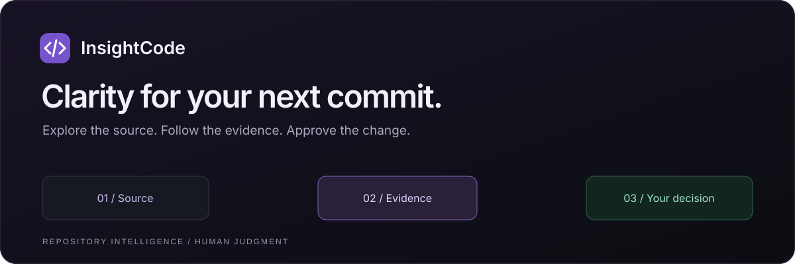
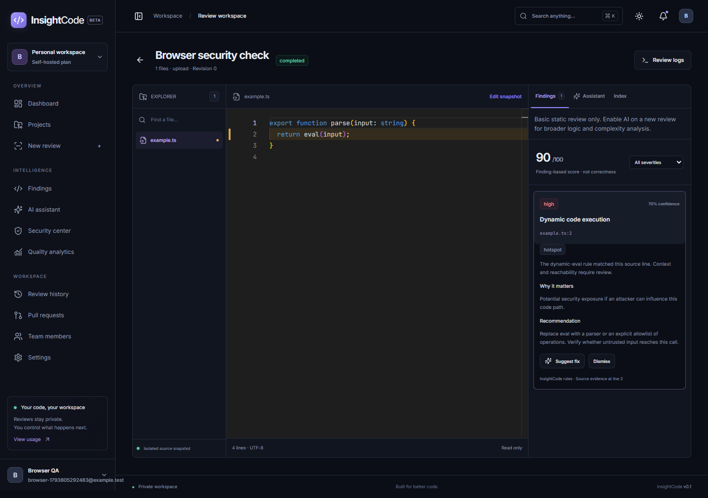
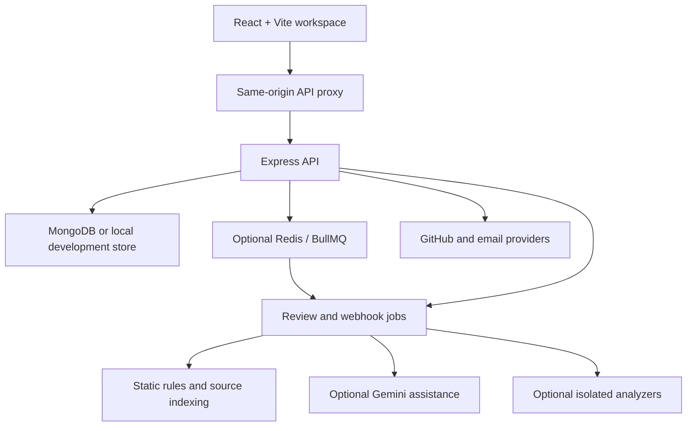

<div align="center">
  
  <h1>InsightCode</h1>
  <p><strong>A focused workspace for thoughtful code review.</strong></p>
  <p>Source-backed findings, repository context, optional Gemini assistance,<br/>and proposed changes you inspect before applying.</p>
  <p><a href="https://insightcode.vercel.app/">Live site</a> · <a href="#quick-start">Quick start</a> · <a href="docs/DEPLOYMENT.md">Deployment</a> · <a href="docs/API.md">API reference</a></p>
  <p><code>React 19</code> <code>TypeScript</code> <code>Vite</code> <code>Motion</code> <code>Express</code> <code>MongoDB</code></p>
</div>

> **Beta software.** Analysis helps you investigate; it does not prove correctness or exploitability. The live site and an open redesign branch can differ.

## From source to a decision

| Step                         | What you do                                                                     | What you get                                                                |
| ---------------------------- | ------------------------------------------------------------------------------- | --------------------------------------------------------------------------- |
| **01 · Bring your code**     | Paste a snippet, upload source files or a bounded ZIP, or import GitHub source. | An isolated review snapshot organized by project.                           |
| **02 · Follow the evidence** | Explore findings, source locations, symbols and dependencies.                   | Context for assessing security hotspots and code issues.                    |
| **03 · Decide what changes** | Inspect proposed diffs, approve snapshot edits and revert when needed.          | A controlled review process, with separate approval for GitHub publication. |

## Inside the workspace

- **Source and evidence together.** Monaco editing and diffs, a file explorer, finding filters, repository indexing and source-linked findings.
- **Optional contextual AI.** Configure Gemini for explanations, analysis and proposed fixes. Enabling AI sends relevant source to the configured provider.
- **GitHub workflows.** Configured OAuth, repository and pull-request imports, approved review comments and signed webhook ingestion.
- **Project organization.** Projects, review history, team roles, notifications, usage and finding-based analytics derived from stored reviews.
- **Accessible interface.** Responsive layouts, light/dark themes, keyboard navigation, branded loading/error screens and reduced-motion support. The redesign adds short Motion reveals, interaction-driven icons and an illustrative review example.
- **Account recovery.** Email/password authentication, optional Google sign-in and reset email through configured Gmail API, SMTP or Resend.

<details>
<summary><strong>Review workspace reference</strong></summary>



This screenshot documents an earlier interface. It is not a screenshot of the latest redesign.

</details>

## Quick start

Use **Node.js 22+** and npm. MongoDB is required for production. Chrome is required for browser tests; a JDK is required for the optional Java runtime checks.

```sh
git clone https://github.com/ayush-gupta456/InsightCode.git
cd InsightCode
npm ci
```

Create your local configuration:

```sh
# macOS / Linux
cp .env.example .env
```

```powershell
# Windows PowerShell
Copy-Item .env.example .env
```

Set a persistent `JWT_SECRET` of at least 32 random characters in `.env`. Generate one with:

```sh
node -e "console.log(require('node:crypto').randomBytes(48).toString('base64url'))"
```

Then start the frontend and API:

```sh
npm run dev
```

Open **http://127.0.0.1:5173** and create an account. The API listens on port **3001** by default. Without MongoDB, development stores data in `data/store.json`; that driver supports one local process.

Keep `.env`, tokens and `data/` out of version control. Credentials belong on the backend, never in `VITE_` variables.

## Configuration map

| Area                   | Variables                                                                                         | Notes                                                                        |
| ---------------------- | ------------------------------------------------------------------------------------------------- | ---------------------------------------------------------------------------- |
| API & browser origin   | `HOST`, `PORT`, `FRONTEND_ORIGIN`, `PUBLIC_API_ORIGIN`                                            | With a frontend API proxy, the public API origin is the frontend origin.     |
| Persistence & sessions | `MONGODB_URI`, `JWT_SECRET`, `DATA_DIR`                                                           | Production requires MongoDB and a stable secret.                             |
| Queue                  | `REDIS_URL`                                                                                       | Enables BullMQ; required for durable webhook jobs and subscriptions.         |
| Gemini                 | `GEMINI_API_KEY`, `GEMINI_MODEL`                                                                  | Optional; select a model available to your account.                          |
| Google sign-in         | `GOOGLE_CLIENT_ID`, `GOOGLE_CLIENT_SECRET`                                                        | Separate from Gmail authorization.                                           |
| Recovery email         | `AUTH_EMAIL_PROVIDER`, `AUTH_EMAIL_FROM`                                                          | Configure Gmail API, supported SMTP or Resend; see the auth guide.           |
| Gmail API              | `GMAIL_CLIENT_ID`, `GMAIL_CLIENT_SECRET`, `GMAIL_REFRESH_TOKEN`                                   | HTTPS email option for hosts that block SMTP.                                |
| GitHub                 | `GITHUB_CLIENT_ID`, `GITHUB_CLIENT_SECRET`, `GITHUB_WEBHOOK_SECRET`, `INTEGRATION_ENCRYPTION_KEY` | Encryption key must encode 32 random bytes as base64.                        |
| Proxy identity         | `TRUSTED_PROXY_CIDRS`                                                                             | Explicit IPs/CIDRs only. Leave blank until the hosting boundary is verified. |
| Isolated analyzers     | `ANALYZER_IMAGE`, `ANALYZERS`, `WORKER_TEMP_DIR`                                                  | Requires a dedicated Docker-capable host.                                    |

See [.env.example](.env.example), [authentication setup](docs/AUTH_SETUP.md) and [deployment guide](docs/DEPLOYMENT.md) for complete setup and callback URLs.

## Architecture



| Directory  | Responsibility                                             |
| ---------- | ---------------------------------------------------------- |
| `src/`     | React routes, shared UI, themes, motion and review editor  |
| `server/`  | API, authorization, persistence, analysis and integrations |
| `shared/`  | Shared types and language helpers                          |
| `workers/` | Optional Docker analyzer image and runner                  |
| `tests/`   | API, security, analysis, token and email regressions       |
| `e2e/`     | Browser interaction, recovery and responsive checks        |
| `scripts/` | Targeted operational verification helpers                  |
| `docs/`    | Architecture, setup, API and validation references         |

Workspace charts and the review editor load on demand. The editor bundle is large; production build output makes that cost visible.

## Commands & verification

| Command                | Purpose                                                     |
| ---------------------- | ----------------------------------------------------------- |
| `npm run dev`          | Start Vite and the TypeScript API watcher                   |
| `npm run build`        | Type-check the project and create `dist/`                   |
| `npm start`            | Start the API with `tsx`                                    |
| `npm test`             | Run backend and analysis regressions                        |
| `npx playwright test`  | Run browser tests against a running frontend                |
| `npm audit --omit=dev` | Inspect currently reported production dependency advisories |

For browser checks, start the app first. `PLAYWRIGHT_BASE_URL` selects another preview address. The redesign branch also supports `PLAYWRIGHT_CHROMIUM_EXECUTABLE` for an alternate Chrome/Chromium binary. Browser fixtures isolate UI behavior from real provider availability.

If the environment blocks the `tsx` CLI's IPC pipe, the equivalent test entry is:

```sh
node --import tsx --test tests/*.test.ts
```

**Latest recorded redesign validation:** the production build passed; 19 tests passed and one Java-runtime test was skipped. Browser execution was blocked by the execution environment, so responsive visual checks remain pending. These results are historical evidence, not live CI badges or verification of external providers.

## Deploy your own

1. **Frontend:** use Vercel, build with `npm run build`, and publish `dist/`. Update the API destination in `vercel.json` for your backend.
2. **API:** configure `NODE_ENV=production`, `HOST=0.0.0.0`, MongoDB, a stable JWT secret and the correct frontend/public origins. Retain development dependencies because `npm start` uses `tsx`.
3. **Integrations:** provision Redis, OAuth credentials, Gemini and email only for the capabilities you enable. Verify each with real credentials.
4. **Workers:** build `workers/Dockerfile` on a Docker-capable host. A Node-only hosting service does not provide analyzer isolation automatically.

The current API uses process-local locks and rate-limit storage. Keep one API instance until shared coordination is implemented. A blank trusted-proxy configuration does not trust forwarded client addresses. Review [deployment details](docs/DEPLOYMENT.md) before production use.

## Security boundaries

- Password hashing, signed access-token validation, rotating refresh sessions and password-reset session invalidation.
- Expiring, hashed, single-use reset tokens; browser-bound Google OAuth state, PKCE and nonce validation.
- Ownership/team checks, bounded uploads, archive path validation, encrypted GitHub credentials and signed webhooks.
- Optional analyzers execute in restricted Docker containers. Submitted source is not executed directly on the API host.
- Snapshot edits and GitHub publishing require explicit user actions. Findings and AI output still need human review.

Production proxy identity, backup recovery, provider delivery, multi-instance coordination and real worker execution require deployment-specific checks. Do not post credentials or private source in public issues.

## Documentation

| Guide                                          | Read it for                                    |
| ---------------------------------------------- | ---------------------------------------------- |
| [Architecture](docs/ARCHITECTURE.md)           | Components, data flow and runtime boundaries   |
| [Deployment](docs/DEPLOYMENT.md)               | Hosting, proxy, queue and worker configuration |
| [Authentication & email](docs/AUTH_SETUP.md)   | OAuth, Gmail and password recovery             |
| [API reference](docs/API.md)                   | Backend routes and workflows                   |
| [Review validation](docs/REVIEW_VALIDATION.md) | Analysis behavior and limitations              |
| [Remediation notes](docs/REMEDIATION.md)       | Earlier review scope and known constraints     |
| [UI/motion sources](docs/UI_MOTION_SKILLS.md)  | Design references and installation status      |

Historical audit documents record conditions at their review dates; use current source and deployment documentation for configuration.

## Contributing

Create a focused branch, describe the user-visible problem and resulting behavior, and run relevant regressions plus the production build. Include desktop/mobile screenshots for UI changes and check both themes, keyboard focus and reduced motion. Keep dependencies purposeful and retain useful regression coverage.

The README banner is a local SVG with a short one-time animation, a reduced-motion alternative and static fallback. No external animation service or JavaScript is required; rendering depends on the Markdown viewer.

## License

No project license is currently declared. Public source visibility alone does not grant unrestricted redistribution rights. Contact the repository owner before reuse or redistribution.
