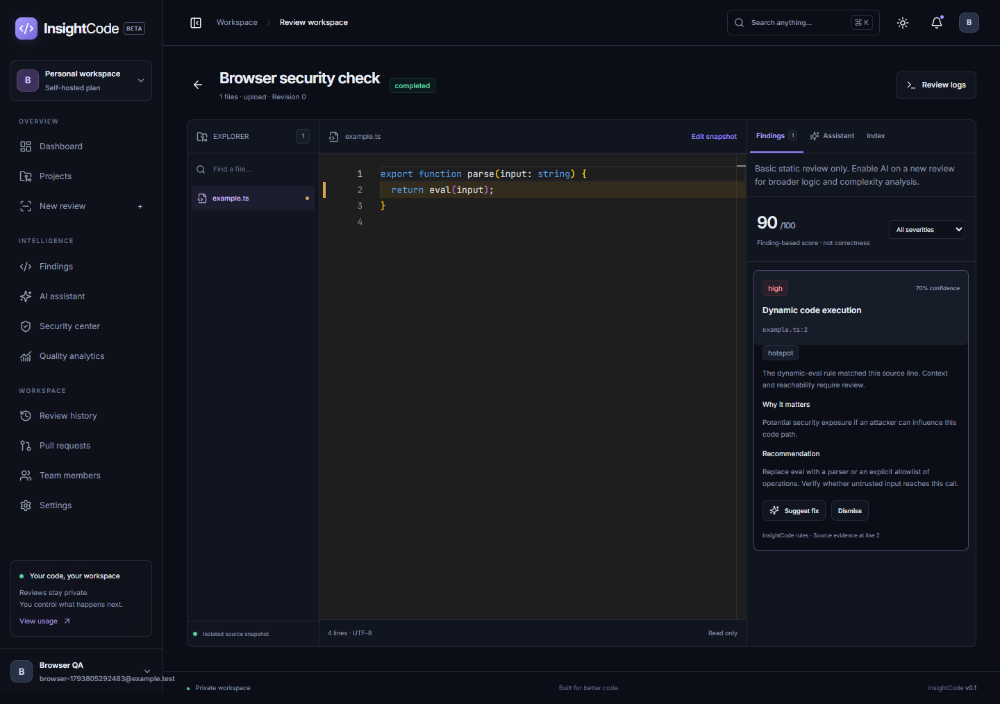

<div align="center">
  
  <h1>InsightCode</h1>
  <p><strong>Understand your code. Review with evidence. Change with confidence.</strong></p>
  <p>A private code-review workspace combining static analysis, optional AI assistance,<br />and a review process that keeps you in control.</p>
  <p>
    <a href="https://insightcode.vercel.app"><strong>Open workspace</strong></a> ·
    <a href="#quick-start">Quick start</a> ·
    <a href="docs/DEPLOYMENT.md">Deploy your own</a> ·
    <a href="docs/API.md">API reference</a>
  </p>
  <p>
    
    
    
    
  </p>
</div>

---

## A clearer view of every finding



*Review workspace example. Visual details may differ from the latest deployment.*

## Built around your review workflow

| Bring your code | Understand the evidence | Make an informed change |
| --- | --- | --- |
| Paste snippets, upload files or bounded ZIP archives, or import GitHub repositories and pull requests. | Explore source, symbols, severity and findings in one workspace. Add Gemini assistance when needed. | Preview a patch, approve changes to an isolated snapshot, and revert when necessary. |

### What makes it useful

- **Evidence beside the code.** Findings point to source locations; security hotspots remain clearly marked for human assessment.
- **Optional, contextual AI.** Gemini can explain code, analyze issues and suggest fixes. Enabling AI sends relevant source to the configured provider.
- **Changes you approve.** Snapshot patches and reverts are separate from explicitly authorized repository publishing.
- **An organized workspace.** Projects, review history, finding-based analytics and deletion of completed reviews you own.
- **Comfortable across screens.** Responsive layouts, light and dark themes, keyboard controls and reduced-motion support.
- **Flexible authentication.** Email/password, configured Google sign-in and password recovery through Gmail API, supported SMTP hosts or Resend.

> **Analysis supports judgment; it does not replace it.** Static rules and AI can miss defects. Scores reflect detected findings, not proof of correctness.

## Explore the documentation

| Guide | What you will find |
| --- | --- |
| [Deployment](docs/DEPLOYMENT.md) | Frontend, API and hosting setup |
| [Authentication & email](docs/AUTH_SETUP.md) | Google sign-in, Gmail authorization and reset emails |
| [Architecture](docs/ARCHITECTURE.md) | Application structure and responsibilities |
| [API reference](docs/API.md) | Backend routes and workflows |
| [Review validation](docs/REVIEW_VALIDATION.md) | Tested analysis behavior and boundaries |
| [Maintenance review](docs/MAINTENANCE_REVIEW.md) | Performance measurements, security work and remaining constraints |

## Quick start

Requires Node.js 22 and npm. Chrome is needed for browser tests. MongoDB is required for production; Redis, Gemini, GitHub and email providers are optional integrations.

```sh
npm ci
```

Copy `.env.example` to `.env`, then run:

```sh
npm run dev
```

Open http://127.0.0.1:5173 and register an account. The API runs on port 3001 by default. Development uses `data/store.json` when MongoDB is absent; this driver is intended for a single local process. Set a persistent `JWT_SECRET` to retain sessions across restarts. Never commit `.env`, tokens or the data directory.

## Configuration

| Purpose | Variables |
| --- | --- |
| API and origin | `HOST`, `PORT`, `FRONTEND_ORIGIN`, `PUBLIC_API_ORIGIN` |
| Production persistence and authentication | `MONGODB_URI`, `JWT_SECRET` (32+ random characters) |
| Queue | `REDIS_URL` |
| Optional Gemini | `GEMINI_API_KEY`, `GEMINI_MODEL` |
| Google sign-in | `GOOGLE_CLIENT_ID`, `GOOGLE_CLIENT_SECRET` |
| Gmail API recovery | `AUTH_EMAIL_PROVIDER=gmail`, `GMAIL_CLIENT_ID`, `GMAIL_CLIENT_SECRET`, `GMAIL_REFRESH_TOKEN`, `AUTH_EMAIL_FROM` |
| GitHub | `GITHUB_CLIENT_ID`, `GITHUB_CLIENT_SECRET`, `GITHUB_WEBHOOK_SECRET`, `INTEGRATION_ENCRYPTION_KEY` |
| Optional Docker analyzers | `ANALYZER_IMAGE`, `ANALYZERS`, `WORKER_TEMP_DIR` |

See [.env.example](.env.example) for defaults and [authentication setup](docs/AUTH_SETUP.md) for exact callback URLs, Gmail authorization and token lifetime considerations. All credentials belong on the backend. Do not expose secrets through `VITE_` variables.

## Architecture

```text
React + Vite frontend (Vercel)
  └─ same-origin /api and /socket.io proxy
      └─ Express + TypeScript API (Render)
          ├─ MongoDB: accounts, reviews, sessions, projects
          ├─ Optional Redis/BullMQ queue
          ├─ Static rules and repository indexing
          ├─ Optional Gemini / GitHub / Gmail integrations
          └─ Optional isolated Docker analyzer runner
```

Workspace/chart pages and the editor are loaded on demand. MongoDB authentication lookups use targeted queries instead of fetching all users or sessions.

| Directory | Responsibility |
| --- | --- |
| `src/` | Application UI, themes, editor and client state |
| `server/` | API, authorization, persistence, integrations and analysis |
| `shared/` | Shared data types |
| `workers/` | Optional analyzer container |
| `tests/` | API, security, analysis and email regression tests |
| `e2e/` | Browser and responsive regression tests |
| `docs/` | Deployment, API, setup and validation notes |

## Deployment

Frontend: Vercel uses `npm run build`, output `dist`, and the rewrites in `vercel.json`. Replace the destination API hostname when deploying your own fork.

Backend: set `NODE_ENV=production`, `HOST=0.0.0.0`, MongoDB and a persistent JWT secret. Build with `npm ci --include=dev && npx tsc --noEmit`; start with `npm start`. The current start command uses `tsx`, so deployment must retain development dependencies. Configure `FRONTEND_ORIGIN` and `PUBLIC_API_ORIGIN` to the frontend origin when using its API proxy.

Render Free blocks SMTP ports; use Gmail API over HTTPS for the documented free deployment. Gmail OAuth authorization is separate from Google sign-in. Docker analyzers require a host with Docker access and are not established by setting an image tag on an ordinary Render Node service.

See [deployment guide](docs/DEPLOYMENT.md) for details. A successful build or health response does not verify external credentials or email delivery.

## Verification

```sh
npm test
npm run build
npm audit --omit=dev
```

With the frontend running and Chrome installed:

```sh
npx playwright test
```

Set `PLAYWRIGHT_BASE_URL` when using a different preview address. Browser fixtures verify UI behavior independently of provider availability. Java runtime checks require a JDK; consult test output for skipped prerequisites.

## Security and limitations

- Passwords use bcrypt. Access tokens require signature, issuer, audience and expiry claims; refresh sessions rotate and reset passwords invalidate prior session versions.
- Reset links are hashed, expiring and single-use. Google OAuth uses browser-bound state, PKCE, nonce and verified identity claims.
- GitHub credentials are encrypted at rest. Webhooks require signatures; uploads enforce path, size and archive limits.
- Optional analyzer containers disable networking and apply resource limits. Untrusted source is not executed directly on the API host.
- Static rules, including Java traversal heuristics, are not a general correctness proof. AI may miss defects or misstate complexity. Scores reflect findings, not guaranteed code quality.
- Production proxy/rate-limit identity, multi-instance concurrency, provider delivery and Docker execution require deployment-specific verification. The editor bundle remains large and loads on demand.

See [review validation](docs/REVIEW_VALIDATION.md) and [current audit](docs/MAINTENANCE_REVIEW.md). Do not post secrets or private source in public bug reports.

## Contributing

Use a focused branch, explain the observed issue and intended behavior, and run relevant tests plus the production build. Include screenshots for interface changes. Avoid adding dependencies or deleting behavior without a demonstrated need.

## License

No open-source license is currently declared. Public source availability alone does not grant unrestricted reuse rights; contact the repository owner before redistribution.
